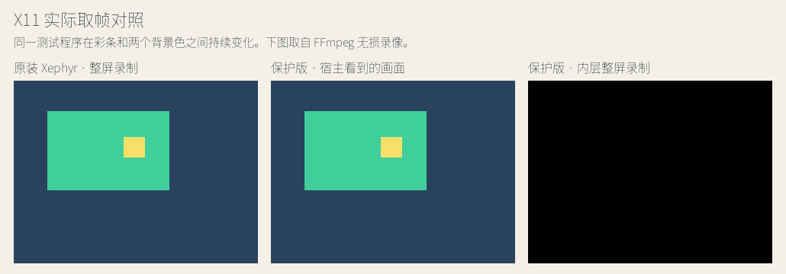

# Don't even think about screen recording

Fedora 专用 X11 展示会话 · v0.1.0

用于展示机播放视频或运行 X11 应用。现场显示原画，连接同一专用 X 服务的常见整屏、窗口录制程序读到黑色像素。适用于 Fedora 45 x86_64。

[下载 Fedora 安装包](https://github.com/shuizhaodemumu/Don-t-even-think-about-screen-recording/releases/download/v0.1.0/x11-showcase-0.1.0-1.fc45.x86_64.rpm) · [观看 10 秒字幕样片实测对照](https://github.com/shuizhaodemumu/Don-t-even-think-about-screen-recording/releases/download/v0.1.0/playback-comparison.mp4) · [Release 与全部附件](https://github.com/shuizhaodemumu/Don-t-even-think-about-screen-recording/releases/tag/v0.1.0)



## 安装与试玩

在 RPM 所在目录运行下面的命令。安装会使用 Fedora 提供的 FFmpeg、字体键盘映射和系统库，需有管理员安装权限。

```bash
sudo dnf install ./x11-showcase-0.1.0-1.fc45.x86_64.rpm
x11-showcase demo
```

从图形桌面运行会打开一个 960 × 540 的独立展示窗口，循环播放 10 秒带中文字幕的河谷样片。点进窗口后按 **Q** 退出。在带 Xwayland 的 Wayland 桌面也可以这样试玩。**外层桌面的录屏工具依然能录到这个窗口**，它录的是外层合成后的画面。要在展台使用，请按下一节直接启动原生会话。

## 原生整屏展示

1. 原生会话需要键盘和鼠标的 Xorg 驱动。先在图形桌面安装一次：`sudo dnf install xorg-x11-drv-libinput`。随后切换至空闲的本地文字终端，例如按 **Ctrl + Alt + F3**。用普通用户在本机登录。
2. 输入 `x11-showcase --native demo`。启动器从当前活动 VT 启动私有 Xorg。通过白色窗口和整屏读取自检后，播放器才会启动。
3. 展示自己的视频可用 `x11-showcase --native play "/路径/展映.mp4"`。运行已有 X11 应用可用 `x11-showcase --native run -- /路径/播放器 参数`。该程序应在前台运行，并在本次会话中新建自己的窗口。依赖硬件 OpenGL 或把请求转给其他桌面上的既有进程的程序需要单独验证。
4. 内置播放器按 **Q** 结束放映，回到该文字终端，再用原桌面所在的 VT 快捷键返回。启动器在前台运行时也可以用 Ctrl+C 结束。诊断输出在 `$XDG_RUNTIME_DIR/x11-showcase/server.log`。

## 验证录制结果

展示画面播放期间，同一用户从另一个终端运行以下命令。原生展台上也可使用同一用户的 SSH 终端，保持展示 VT 在前台。

```bash
x11-showcase record "$HOME/x11-check.mkv" --seconds 5
ffplay -autoexit "$HOME/x11-check.mkv"
```

第一条启动真实的 FFmpeg X11 输入，直接连接正在运行的专用服务，以无损 FFV1 录制视频。第二条应在普通桌面上回放，便于确认文件内容。重复测试请换文件名。可选的 `--window-id 0x窗口编号` 测试单个窗口。`x11-showcase info` 会打印可供独立 X11 程序使用的 DISPLAY 和 XAUTHORITY。测试录制只包含视频轨，音频回环仍由原系统管理。

## 已验证范围

| 检查 | 结果 |
| --- | --- |
| FFmpeg 的 X11 整屏、含鼠标的整屏、单窗口、首次映射、切换全屏和重新映射 | 专用 Xephyr、原生 Xorg 配虚拟 dummy 显示驱动各录制 141 帧，逐帧解码的 RGB 全部为 0 |
| 相同环境下的原装 Xephyr 和原装 Xorg | 相同脚本可录到彩色动态图像 |
| 展示端输出 | 对隔离测试桌面从外侧录制，24 帧有 23 次画面变化 |
| 普通 XGetImage 和 MIT-SHM 共享内存读取 | 整屏和窗口均为黑色；XFixes 返回的鼠标图像透明 |
| GStreamer ximagesrc | 专用 Xephyr 和原生 Xorg 配虚拟驱动的整屏和窗口各录制 16 帧，全部为黑色 |

本次原生测试使用 Fedora 的虚拟显示驱动。实体 GPU、物理显示器、显卡驱动和 OBS 的不同采集源需要在目标展机上验证。这个版本只处理专用 X11 服务的画面读取。音频、物理 HDMI 采集、手机拍摄、具有系统特权的读取、同一用户控制播放器或读取媒体本身，均在保护范围以外。

成品 RPM 内的播放器也做了独立验证。同一段 10 秒字幕样片从外侧采到 150 帧，全部不同，从专用会话内侧采到 250 帧，全为 RGB(0,0,0)。两路采集分别使用 15 fps 和 25 fps。样片循环与按 Q 退出均通过。回归测试可以从仓库直接运行。[测试说明](tests/README.md)

## 实现与来源

专用服务基于 X.Org Server 21.1.26，随 RPM 安装在私有路径。服务在 X11 GetImage 和 MIT-SHM GetImage 的回复里返回黑色，XFixes 的光标读取返回透明图像。补丁保留本地显示写入路径，并关闭共享像素图导出。软件渲染配置关闭了 DRI、GLX、XVideo 和 DGA。启动器同时关闭 X11 的 RECORD 协议记录扩展。保护对专用会话内所有窗口生效，截图、吸管和依赖像素回读的应用也会读到黑色。系统常用的 Xorg 和 Xwayland 可以继续独立使用。

源码 RPM 包含原始压缩包、补丁、启动器、样片和构建 spec。上游 tar.xz 的 SHA-256 可对照该版本 Fedora 签名源码包中的同一文件。上游许可随安装包的 COPYING 提供。启动器与项目演示素材采用 MIT 许可，样片取自 Photo60 0.4.1 的原创河谷素材，并重新编码为 VP9。[X.Org 上游源码](https://www.x.org/releases/individual/xserver/xorg-server-21.1.26.tar.xz) · [样片原项目与制作说明](https://github.com/shuizhaodemumu/Anti-copying-of-video/blob/v0.4.1/THIRD_PARTY.md)

可在 Fedora 45 的干净构建环境中用 `mock -r fedora-45-x86_64 --rebuild x11-showcase-0.1.0-1.fc45.src.rpm` 按 spec 重建。专用服务需要随 Fedora 的 X.Org 安全更新维护。卸载命令为 `sudo dnf remove x11-showcase`。

## 从本仓库构建

在 Fedora 45 x86_64 上安装 `rpm-build`，用 `sudo dnf builddep ./x11-showcase.spec` 安装声明的构建依赖，再执行 `bash build-rpm.sh`。脚本下载固定的 X.Org 压缩包，验证 SHA-256 并在临时目录构建。Release 的源码 RPM 已在另一构建目录重建，全部安装文件与发布包逐字节一致。发布的 RPM 未签名，可用同一 Release 的 SHA256SUMS.txt 核对文件完整性。
